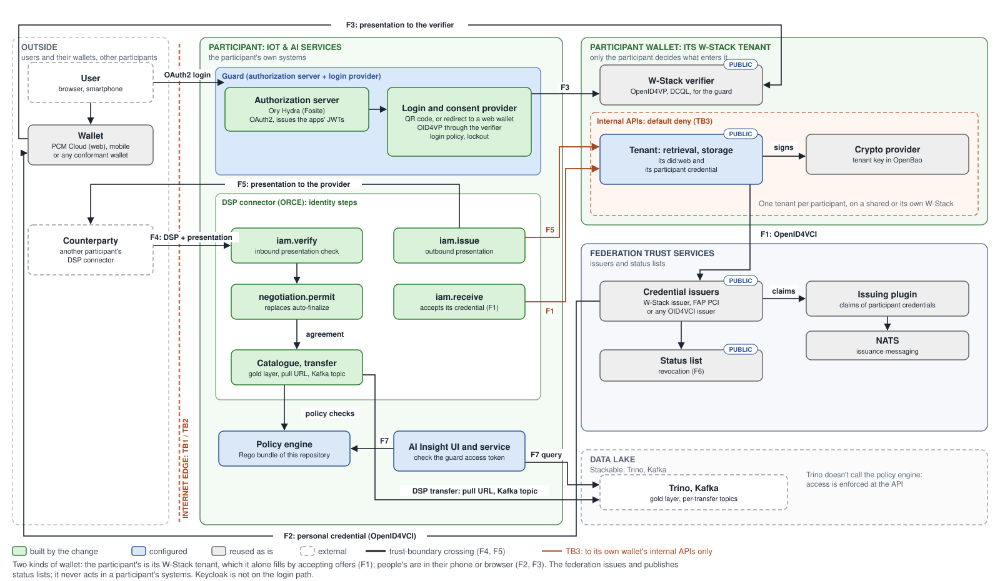
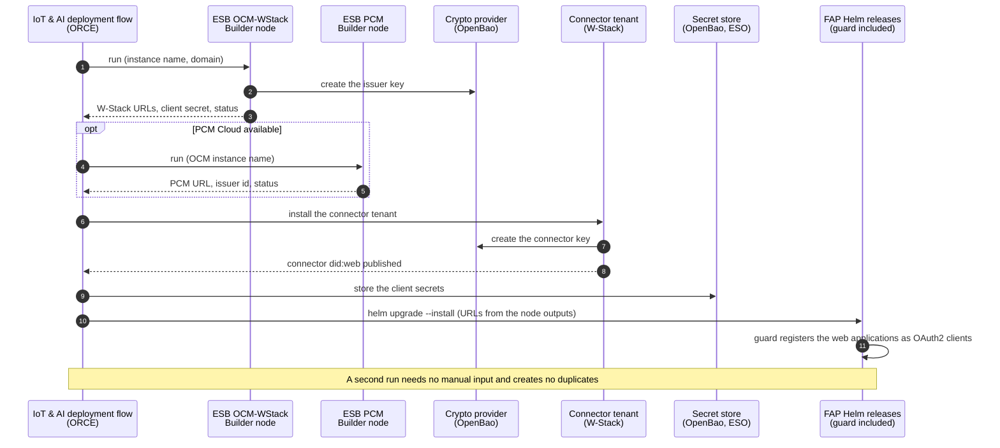
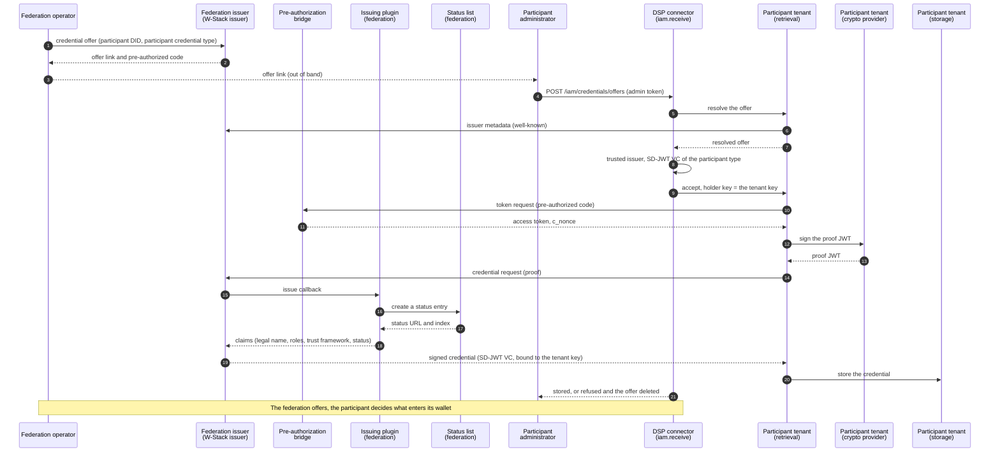
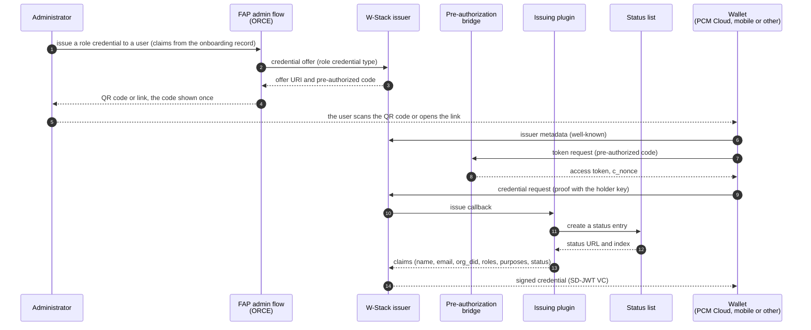
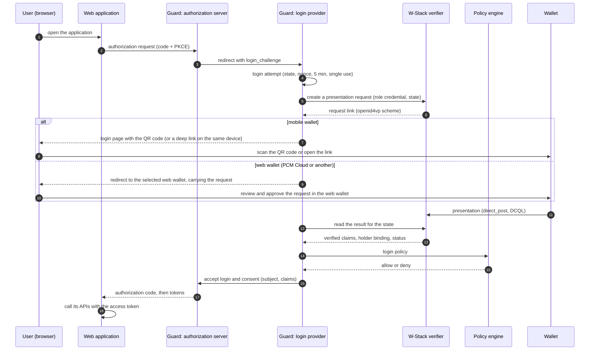
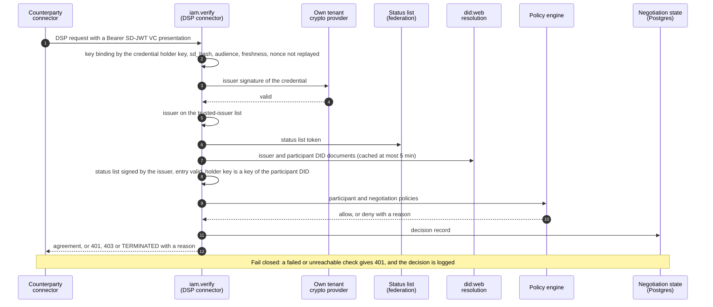
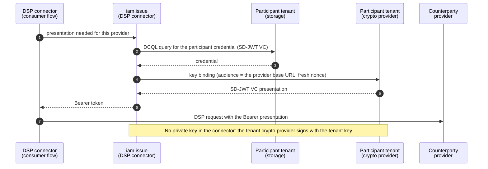
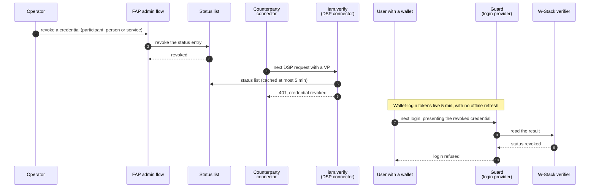
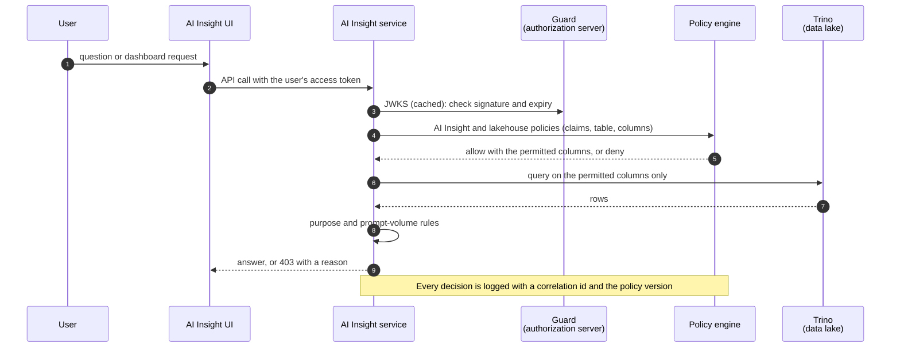
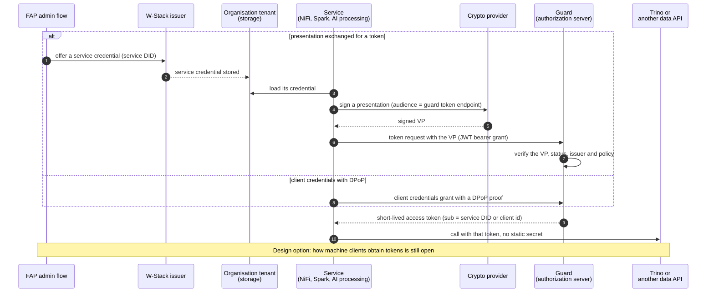

# Identity and access: overview and flows

Companion to the [target architecture](icam-target-architecture.md). It shows the whole picture and the sequence of each flow, F0 to F8. The flow numbers are the labels used in the overview.

Every diagram has an editable source in [`diagrams/`](diagrams/README.md): the overview for draw.io, each sequence for sequencediagram.org. The Mermaid copies below render on GitHub and must be kept in step with those sources.

## Overview

Editable source: [`diagrams/icam-overview.drawio`](diagrams/icam-overview.drawio).

| Zone | Contents |
|---|---|
| Outside | Users with their browser or smartphone and their wallets, other participants' DSP connectors |
| Participant: the IoT & AI services | The guard, the DSP connector with its identity steps, AI Insight, the policy engine |
| Participant: its wallet | Its W-Stack tenant: credential retrieval and storage, the crypto provider with the participant's key, and the verifier the guard uses. Run by the participant, or for it, but only the participant decides what enters it |
| Federation trust services | The issuers of participant and role credentials (W-Stack issuer, issuing plugin, pre-authorization bridge), their status lists and `did:web` documents, the trusted-issuer list. Keycloak is no longer on the login path |
| Data lake | Trino and Kafka, reached by the connector for transfers and by AI Insight for queries |

Federation and participants are decoupled: only public protocol crosses between them (OpenID4VCI offers and requests, `did:web` documents, status lists, presentations). The federation's operators issue and revoke; they never act inside a participant's systems.

Trust boundaries:

- **TB1, Internet to the federation services:** only the public routes (OpenID4VCI, `did:web`, well-known documents, status list).
- **TB2, Internet to the FAP:** the DSP endpoints, where every request carries a verified presentation (F4), and the web applications, behind the guard (F3).
- **TB3, the IoT & AI services to their own wallet's internal APIs:** the connector and the guard call their tenant's retrieval, storage, crypto provider and verifier, nothing of the federation's. These APIs don't authenticate callers, so default-deny network policies are the control.

## F0. Deployment with the Builder nodes

The Easy Stack Builder nodes deploy the trust services; their outputs configure the IoT & AI deployment, the guard included, with no manual copying. The issuer key and the connector key are created in the crypto provider, and the connector's `did:web` is published.

Editable source: [`diagrams/sequences/f0-deployment.txt`](diagrams/sequences/f0-deployment.txt)

## F1. Organisation credential

The federation issuer offers the participant credential; the participant's connector decides whether to accept it into its own wallet, its W-Stack tenant. The connector accepts only an SD-JWT VC of the participant credential type from a trusted issuer, with the tenant's key as holder key. The issuing plugin, on the federation side, supplies the claims and registers the credential in the status list.

Editable source: [`diagrams/sequences/f1-organisation-credential.txt`](diagrams/sequences/f1-organisation-credential.txt)

## F2. Personal credential

An administrator issues a role credential to a user's wallet over OpenID4VCI. The claims come from the onboarding record. The credential can be re-issued and revoked.

Editable source: [`diagrams/sequences/f2-personal-credential.txt`](diagrams/sequences/f2-personal-credential.txt)

## F3. Wallet login through the guard

Any FAP web application sends the user to the guard. The login provider asks the W-Stack verifier for a presentation, shows it as a QR code for a mobile wallet or redirects to a web wallet, applies the login policy, and lets the authorization server issue the tokens. Rules in [the target architecture, §4](icam-target-architecture.md#4-person-login).

Editable source: [`diagrams/sequences/f3-wallet-login.txt`](diagrams/sequences/f3-wallet-login.txt)

## F4. DSP inbound check

A counterparty's DSP request carries an SD-JWT VC presentation of its participant credential. The connector checks it, fails closed, logs the result, and asks the policy engine before any agreement or transfer. It checks the key binding itself; its own tenant's crypto provider checks the issuer's signature.

Editable source: [`diagrams/sequences/f4-dsp-inbound.txt`](diagrams/sequences/f4-dsp-inbound.txt)

## F5. DSP outbound presentation

The connector takes its participant credential from its tenant's storage, has the tenant's crypto provider add the key binding for this provider, and attaches the presentation to its DSP requests.

Editable source: [`diagrams/sequences/f5-dsp-outbound.txt`](diagrams/sequences/f5-dsp-outbound.txt)

## F6. Revocation

An operator revokes a credential. The next DSP check and the next wallet login fail, within 5 minutes.

Editable source: [`diagrams/sequences/f6-revocation.txt`](diagrams/sequences/f6-revocation.txt)

## F7. Data and AI access

AI Insight checks the user's guard access token, the policy engine decides on role, organisation and purpose, and Trino is queried on the permitted columns only.

Editable source: [`diagrams/sequences/f7-data-and-ai-access.txt`](diagrams/sequences/f7-data-and-ai-access.txt)

## F8. Machine identity (design option)

Services obtain a short-lived token from the guard instead of using static secrets. Which of the two ways is used is an open point of the target architecture (§10).

Editable source: [`diagrams/sequences/f8-machine-identity.txt`](diagrams/sequences/f8-machine-identity.txt)
