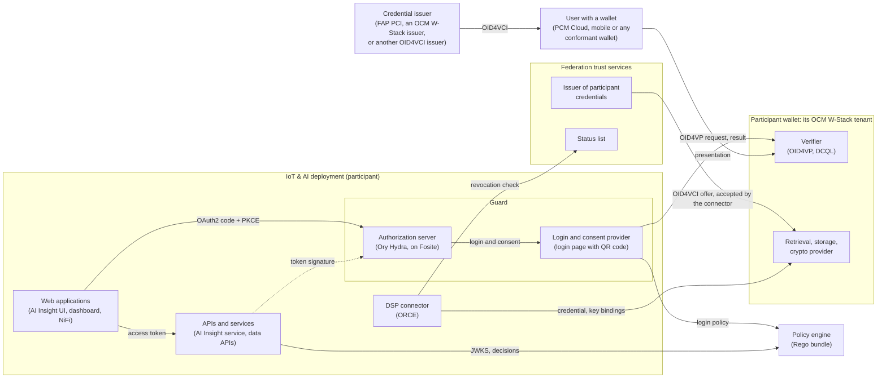
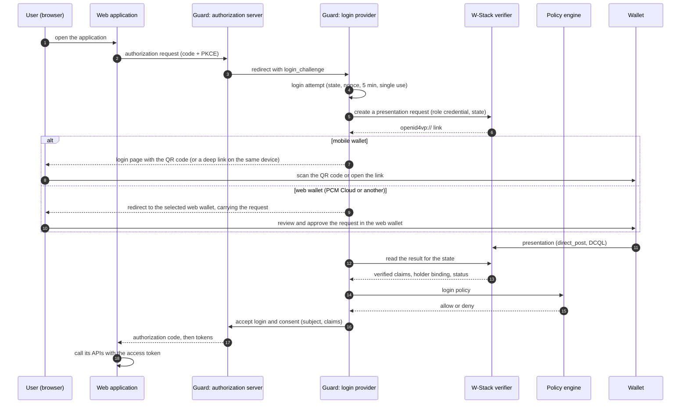

# Identity and access: target architecture

**Status:** draft for discussion with the FACIS maintainers and the Zero Trust Demonstrator team.

This document describes how the FAP IoT & AI handles identity and access once its self-built SSI
components are replaced by the XFSC OCM W-Stack, and how people log in with a wallet through a
guard. It follows the "blue box" guard pattern of the Zero Trust Demonstrator and stays aligned
with it, without depending on its release.

## 1. Scope

In scope:

- **People** log in to the FAP web applications by presenting a role credential from their wallet
  (OpenID4VP). No password.
- **Organisations**: each IoT & AI deployment's DSP connector holds its participant credential in an OCM
  W-Stack tenant and proves its identity to counterparties with it.
- **Authorization** follows the claims of the verified credentials (organisation, roles, purpose),
  evaluated as policy.
- **Revocation** through the W-Stack status list.

Out of scope: changes to the OCM W-Stack, PCM Cloud or TSA components themselves.

## 2. Overview

The guard replaces the identity provider role for the web applications: it issues their tokens
after a verified presentation. The OCM W-Stack verifies presentations; it does not issue
application tokens. Where the policy engine runs, in the IoT & AI deployment or as a shared policy
service, is open.

The detailed picture, with the zones and trust boundaries, and the sequence of every flow (deployment,
credential issuance, wallet login, DSP checks, revocation, data access, machine identity) are in
[Identity and access: overview and flows](icam-flows.md). Their editable sources, for draw.io and
sequencediagram.org, are in [`diagrams/`](diagrams/README.md).

## 3. Components

| Component | Role | Source |
|---|---|---|
| **Guard: authorization server** | OAuth2 / OpenID Connect provider for the FAP web applications. Issues short-lived signed JWT access tokens and ID tokens. Holds no users and no passwords | Ory Hydra (built on Fosite), deployed with the FAP |
| **Guard: login and consent provider** | Serves the login page with the QR code, or redirects the browser to the user's web wallet with the request; creates the presentation request at the W-Stack verifier, reads the result, applies the login policy, then accepts the login and consent at the authorization server | Built for the FAP, following the guard blueprint of the Zero Trust Demonstrator |
| **OCM W-Stack verifier** | Creates OpenID4VP requests (DCQL) and verifies presentations: signature, holder binding, expiry, status | XFSC OCM W-Stack |
| **OCM W-Stack connector tenant** | Holds the DSP connector's DID (`did:web`), keys and participant credential; signs its presentations | XFSC OCM W-Stack |
| **Status list** | Revocation of every credential type | XFSC OCM W-Stack |
| **Policy engine** | Evaluates the Rego policies: login, catalogue, negotiation, transfer, AI Insight and data access | Rego bundle in this repository |
| **Wallets** | Hold the people's role credentials | PCM Cloud, a mobile wallet, or any conformant wallet (§7) |
| **Issuers** | Issue credentials over OpenID4VCI | FAP Principal Credential Issuance, an OCM W-Stack issuer tenant, or another issuer such as Paradym |

## 4. Person login

Login rules:

- The login page offers both ways to present: a QR code (or deep link) for a mobile wallet, and a
  redirect that carries the `openid4vp://` request to a web wallet such as PCM Cloud. The web wallets
  the login page can redirect to are set in configuration; a single one is enough to start.
- A login attempt is single use and expires after 5 minutes; it can be renewed while it is pending.
- The credential's issuer must be trusted, and may only vouch for the organisations its trust
  entry names.
- At least one role allowed for the application must be disclosed; otherwise the login is refused.
- Repeated failed attempts lock out the client address and the holder key for a while; an
  administrator can list and lift lockouts, and both actions are audited.
- Tokens from a wallet login live 5 minutes, with no offline refresh, so a revoked credential stops
  working at the next login.

### The guard in a IoT & AI deployment

- **What is deployed:** the authorization server (Ory Hydra) with its own PostgreSQL database, and
  the login and consent provider. Both run in the IoT & AI deployment, next to the web applications.
- **Clients:** each web application (AI Insight UI, dashboard, NiFi) is registered as an OAuth2
  client: authorization code with PKCE, fixed redirect URIs. Consent is skipped for these
  first-party clients; the login policy is the gate.
- **Tokens:** access tokens are signed JWTs, so APIs check them against the guard's JWKS without a
  call per request. The login provider puts the verified claims (§5) into the access and ID tokens
  when it accepts the login and the consent.
- **Exposure:** only the public OAuth2 and OpenID Connect endpoints and the login page are reachable
  from outside. The authorization server's admin API is reachable only by the login provider.
- **Configuration:** the trusted issuers, the organisations each one may vouch for and the roles
  allowed per application are deployment data of the policy engine, so the login rules are decided
  and tested in one place (`facis.login`); the login provider sends the credential's issuer and the
  application with each decision. The login provider's own configuration names the verifier, the
  status list origins of the trusted issuers and the web wallets the login page may redirect to.
- **Logout** ends the guard session. Tokens already issued expire within 5 minutes.
- **Keycloak** is no longer on the login path of the web applications. The Easy Stack Builder nodes
  still use their own Keycloak for the W-Stack and PCM Cloud.

## 5. Tokens and claims

The access and ID tokens carry the claims of the verified credential. Names and values follow the
[credential schemas](../../schemas/credentials/README.md):

| Claim | Meaning |
|---|---|
| `sub` | Holder DID of the person, or the service DID for a machine client |
| `org_did` | DID of the organisation the person or service belongs to |
| `roles` | `administrator`, `operator`, `data_engineer`, `data_scientist`, `data_analyst` |
| `purpose` | Declared purposes, for example `operations`, `analytics`, `research`, `ai_insight`, `maintenance` |
| `name`, `email` | People only, for display |
| `client_id` | Machine clients only |

APIs check the token signature against the guard's JWKS, then ask the policy engine. No API trusts
role headers.

## 6. Organisation identity and DSP

- The DSP connector is its participant's holder. The federation issuer offers the participant
  credential; the connector accepts it, after checking the issuer and the credential type, into
  its W-Stack tenant over OpenID4VCI (F1). The federation never acts inside the participant's
  wallet.
- On each DSP request it presents that credential, an SD-JWT VC, with a key binding for the
  counterparty (audience, fresh nonce), signed by its tenant's crypto provider. Keys never leave
  the W-Stack.
- The provider side checks the key binding against the key the credential binds, which must be a
  key of the participant's `did:web`, has its crypto provider check the issuer's signature, checks
  freshness, replay, the status list and the trusted issuer, fails closed, logs the result, and
  asks the policy engine before any agreement or transfer. The profile is in
  [`../icam/dsp-identity-profile.md`](../icam/dsp-identity-profile.md).

This keeps the DSP wire contract simple. The Zero Trust Demonstrator exchanges a presentation for a
DPoP-bound access token between connectors (§9); the FAP can adopt that exchange later by replacing
its verification step, with the same claims.

## 7. Wallets and credential formats

- Any wallet that supports OpenID4VCI (receive) and OpenID4VP with DCQL (present) can be used:
  a mobile wallet scans the QR code, a web wallet receives the request through a redirect (§4).
- PCM Cloud is supported as soon as a release that speaks DCQL is available. Until then, a
  conformant alternative wallet is used, and the same flows and tests apply.
- Credential format: SD-JWT VC (`dc+sd-jwt`) with key binding, for the participant and the role
  credentials: the format the W-Stack's crypto provider and verifier check. The schemas generate
  it next to `jwt_vc_json` (`schemas/credentials`).

## 8. Revocation

An operator revokes a credential in the status list. The next DSP check (status list cached for at
most 5 minutes) and the next wallet login fail. Tokens already issued expire within 5 minutes.

## 9. Alignment with the Zero Trust Demonstrator

The FAP follows the demonstrator's patterns where they apply, and does not wait for its release.

| Shared with the demonstrator | How |
|---|---|
| Guard pattern | Authorization server plus login provider, OpenID4VP through the W-Stack verifier |
| Verifier client | One contract: create a request with our own state, read the result by state (verified or not, holder binding, status, disclosed claims) |
| Claim set | Same claim names and role values in tokens (§5), so policies don't depend on the path a caller took |
| Policy | Rego, with a policy input close to the demonstrator's |

| Not required for the FAP today | Later alignment |
|---|---|
| Connector-to-connector token exchange with DPoP | Replace the FAP connector's verification step, keep the claims |
| SPIFFE workload identity, attested TLS, TRAIN trust lists | mTLS between the FAP and the W-Stack internal APIs; mapping between SPIFFE trust domains and participant DIDs to be defined |
| Envoy guard in front of every API (`ext_authz`) | Possible once the demonstrator's guard adapter is deployable |

## 10. Open points

- Whether Keycloak stays in a IoT & AI deployment, for example for administrator access or as a
  fallback, or is removed once the guard is in place.
- Where the login provider runs: as an ORCE flow next to the DSP connector, or as a small service
  reused from the demonstrator's guard.
- How machine clients (NiFi, Spark, AI processing) obtain tokens: client credentials with DPoP from
  the guard, as in the demonstrator, or a presentation exchanged for a token.
- How the user chooses a web wallet when several are configured: a list on the login page, a
  remembered choice, or a hint from the application. The first version uses one configured wallet.
- Whether the verifier lets the response URL be set per profile.
